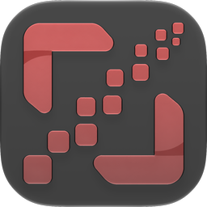
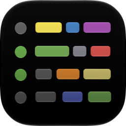

<h1 align="center">TotalDesktop</h1>

Free professional apps for the Total.js community, available on macOS, Windows, and Linux, with tablet versions where appropriate.

  
  
  

## The apps

<!-- catalog -->

<table>
  <tr><th align="left" width="220">App</th><th align="left">What it does</th></tr>
  <tr><td colspan="2"><b>Automation</b></td></tr>
  <tr><td width="220">&nbsp;&nbsp;<a href="lesscode/"><b>LessCode</b></a></td><td>Design and run Total.js flows on your computer, and let your AI build them with you through MCP.</td></tr>
  <tr><td colspan="2"><b>Code</b></td></tr>
  <tr><td width="220">&nbsp;&nbsp;<a href="totalcode/"><b>TotalCode</b></a></td><td>Your Total.js Code instances in windows of their own, with the local copy of files and your passwords in the keychain.</td></tr>
  <tr><td colspan="2"><b>System</b></td></tr>
  <tr><td width="220">&nbsp;&nbsp;<a href="totalfetch/"><b>TotalFetch</b></a></td><td>A summary of your computer in your terminal, with your logo, your colour and your lines.</td></tr>
</table>

<!-- /catalog -->

## What every app offers

- **Free.** Nothing to pay: no trials, no subscriptions, no in-app purchases.
- **On your system.** macOS (Apple silicon and Intel), Windows and Linux, on x64 and ARM64.
- **Private.** No telemetry. Passwords and keys stay in the secure store of your system.
- **Keyboard first.** Shortcuts for every action.
- **Accessible.** Screen readers, high-contrast themes, system text size and reduced motion.
- **Signed.** The macOS apps are signed and notarized by Apple. The Windows installers are not signed yet: the first time, SmartScreen says it protected your PC; choose **More info → Run anyway**.

## Report a problem

[Open an issue](https://github.com/totaljs-es/totaljs-desktop/issues/new/choose) and choose the app, its version and your system.
