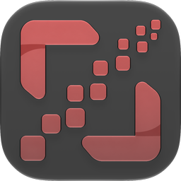

<!-- header -->
<p align="center"></p>

<h1 align="center">LessCode</h1>

<p align="center">Design and run Total.js flows on your computer, and let your AI build them with you through MCP.</p>

<p align="center">
  
  
  
</p>

<h2 align="center" id="download">Download</h2>

<p align="center">
  <b>macOS</b> <a href="https://github.com/totaljs-es/totaljs-desktop/releases/download/lesscode-latest/LessCode-mac.dmg">Apple silicon and Intel</a><br>
  <b>Windows</b> <a href="https://github.com/totaljs-es/totaljs-desktop/releases/download/lesscode-latest/LessCode-windows-x64-setup.exe">x64</a> · <a href="https://github.com/totaljs-es/totaljs-desktop/releases/download/lesscode-latest/LessCode-windows-x64.msi">x64 MSI</a> · <a href="https://github.com/totaljs-es/totaljs-desktop/releases/download/lesscode-latest/LessCode-windows-arm64-setup.exe">ARM64</a><br>
  <b>Linux x64</b> <a href="https://github.com/totaljs-es/totaljs-desktop/releases/download/lesscode-latest/LessCode-linux-amd64.deb">deb</a> · <a href="https://github.com/totaljs-es/totaljs-desktop/releases/download/lesscode-latest/LessCode-linux-x86_64.rpm">rpm</a> · <a href="https://github.com/totaljs-es/totaljs-desktop/releases/download/lesscode-latest/LessCode-linux-x86_64.AppImage">AppImage</a><br>
  <b>Linux ARM64</b> <a href="https://github.com/totaljs-es/totaljs-desktop/releases/download/lesscode-latest/LessCode-linux-arm64.deb">deb</a> · <a href="https://github.com/totaljs-es/totaljs-desktop/releases/download/lesscode-latest/LessCode-linux-aarch64.rpm">rpm</a> · <a href="https://github.com/totaljs-es/totaljs-desktop/releases/download/lesscode-latest/LessCode-linux-aarch64.AppImage">AppImage</a>
</p>
<!-- /header -->

LessCode is the visual designer of [Total.js](https://www.totaljs.com) flows as a desktop app for Windows, Linux and macOS. Drop components on the canvas, connect them and watch real data move through your design. Node.js and Total.js come inside the app: nothing to install, nothing to set up.

## What it does

- **The official LessCode designer** in a window of its own, running on the Node.js and Total.js inside the app.
- **On this computer only.** LessCode answers on `127.0.0.1`, never on your network.
- **Your flows are yours.** They are saved in the data folder of the app and survive its updates. **Flows → Show the folder of the flows** opens it.
- **Nothing is lost when you close it.** LessCode saves every flow before it stops.

## Connect your AI

LessCode speaks [MCP](https://modelcontextprotocol.io), the protocol AI clients use to work with apps. Claude, Cursor or any MCP client can read your flow, change it, run its nodes and write new components for you.

Open **AI → Connect an AI…** in LessCode. The window shows the address, the token and the configuration of each client, ready to copy.

### The address and the token

| | |
| --- | --- |
| MCP endpoint | `http://127.0.0.1:7230/$mcp/` |
| Code mode | `http://127.0.0.1:7230/$mcp/client.js` |
| Authentication | `Authorization: Bearer <token>` |

LessCode takes the port `7230` when it is free, or the next free one up to `7239`, so your AI clients keep working from one launch to the next. The token is made the first time and kept in the keychain of your computer. Without it, LessCode answers `401`: a web page open in your browser cannot reach your flows. If the token reaches someone it should not, **Make a new token** in the same window.

### Claude Code

Keep the single quotes: without them the shell reads `$mcp` as a variable and drops it. `--scope user` makes LessCode available in every project.

```bash
claude mcp add --scope user --transport http lesscode 'http://127.0.0.1:7230/$mcp/' --header 'Authorization: Bearer <token>'
```

### Cursor and other MCP clients

```json
{
  "mcpServers": {
    "lesscode": {
      "url": "http://127.0.0.1:7230/$mcp/",
      "headers": { "Authorization": "Bearer <token>" }
    }
  }
}
```

### Claude Desktop

Claude Desktop starts local servers by command, so it reaches LessCode through [`mcp-remote`](https://www.npmjs.com/package/mcp-remote) (it needs Node.js). In `claude_desktop_config.json`:

```json
{
  "mcpServers": {
    "lesscode": {
      "command": "npx",
      "args": ["-y", "mcp-remote@0.16.5", "http://127.0.0.1:7230/$mcp/", "--allow-http", "--header", "Authorization:${LESSCODE_TOKEN}"],
      "env": { "LESSCODE_TOKEN": "Bearer <token>" }
    }
  }
}
```

### Code mode

Instead of calling the tools one by one, an agent can download a JavaScript client with one function per tool, write a script that uses them, and send only the result back to the model. It needs fewer tokens and finishes long tasks faster.

```bash
curl -H 'Authorization: Bearer <token>' 'http://127.0.0.1:7230/$mcp/client.js' -o lesscode.js
```

```js
// Node.js 18+
const api = require('./lesscode.js')('<token>');

const flow = await api.Flow_read({});
for (const node of Object.values(flow.design))
  node.x += 40;
await api.Flow_save({ input: { design: flow.design } });
```

### The tools

| Tool | What it does |
| --- | --- |
| `Flow_read` | The whole design: every node with its component, config, connections and position, the variables, and whether the flow is paused. |
| `Flow_save` | Applies a new design, as **Apply** does in the designer. |
| `Flow_components` | The installed components with their inputs, outputs and default config. |
| `Component_read` | The source code of a component. |
| `Component_save` | Installs a component or replaces its code. |
| `Component_remove` | Uninstalls a component. |
| `Flow_trigger` | Runs a node, as its **Run** button does. |
| `Flow_status` | The counters of the flow, its last errors and the stats of each node. |
| `Flow_pause` | Pauses or resumes the flow. |

## Download

The Windows installers are not signed yet: the first time, SmartScreen says it protected your PC; choose **More info → Run anyway**.

## Report a problem

[Open an issue](https://github.com/totaljs-es/totaljs-desktop/issues) and say that it is about LessCode, with its version and your system.
