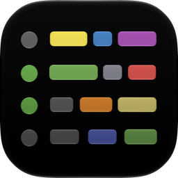

<!-- header -->

<h1 align="center">TotalCode</h1>

Your Total.js Code instances in windows of their own, with the local copy of files and your passwords in the keychain.

  
  
  

<h2 align="center" id="download">Download</h2>

  <b>macOS</b> <a href="https://github.com/totaljs-es/totaljs-desktop/releases/download/totalcode-latest/TotalCode-mac.dmg">Apple silicon and Intel</a> 
  <b>Windows</b> <a href="https://github.com/totaljs-es/totaljs-desktop/releases/download/totalcode-latest/TotalCode-windows-x64-setup.exe">x64</a> · <a href="https://github.com/totaljs-es/totaljs-desktop/releases/download/totalcode-latest/TotalCode-windows-x64.msi">x64 MSI</a> · <a href="https://github.com/totaljs-es/totaljs-desktop/releases/download/totalcode-latest/TotalCode-windows-arm64-setup.exe">ARM64</a> 
  <b>Linux x64</b> <a href="https://github.com/totaljs-es/totaljs-desktop/releases/download/totalcode-latest/TotalCode-linux-amd64.deb">deb</a> · <a href="https://github.com/totaljs-es/totaljs-desktop/releases/download/totalcode-latest/TotalCode-linux-x86_64.rpm">rpm</a> · <a href="https://github.com/totaljs-es/totaljs-desktop/releases/download/totalcode-latest/TotalCode-linux-x86_64.AppImage">AppImage</a> 
  <b>Linux ARM64</b> <a href="https://github.com/totaljs-es/totaljs-desktop/releases/download/totalcode-latest/TotalCode-linux-arm64.deb">deb</a> · <a href="https://github.com/totaljs-es/totaljs-desktop/releases/download/totalcode-latest/TotalCode-linux-aarch64.rpm">rpm</a> · <a href="https://github.com/totaljs-es/totaljs-desktop/releases/download/totalcode-latest/TotalCode-linux-aarch64.AppImage">AppImage</a>

<!-- /header -->

TotalCode is the desktop app of [Total.js Code](https://github.com/totaljs/code) 2, the editor of Total.js in your browser: your Code instances in windows of their own, on macOS, Windows and Linux.

## What it does

- **Your Code Editors as cards.** Each card shows the name, the local path, the address and the version of Code, or **Offline**. Search with ⌘F (Ctrl+F); Enter opens the first that matches.
- **A window becomes Code.** Choose a card and that window turns into the editor, in the same place and size. **Code Editors** (⌘⇧L) turns it back into the list, **New window** (⌘N) opens another one.
- **The local copy of your files.** With a path to your repositories, Code offers *Save locally*, *Download last changes locally*, *Download source-code locally* and *Always local storing files*. TotalCode writes only inside that folder, and every repository gets its own subfolder.
- **Your passwords in the keychain.** When you sign in to a Code, TotalCode offers to keep the password in the keychain of your system. Next time, a bar on the sign-in page fills it after Touch ID or the password of your Mac. The form of each Code Editor lists its saved sign-ins to remove them.
- **Export & Import.** The list of your Code Editors as text, in the format of the Electron app of Code, to move it to another computer. A path for auto-backup keeps a copy after every change.
- **Downloads and links.** Bundles and files go to the folder of the editor (bundles to `bundles/`), or to Downloads. Links to other sites open in your browser.

## Keyboard

| Keys | Action |
| --- | --- |
| ⌘F / Ctrl+F | Search the Code Editors |
| Enter (in the search) | Open the first one that matches |
| Alt + arrow (on a card) | Move it in the list |
| ⌘⇧L / Ctrl+Shift+L | Back to the Code Editors |
| ⌘N / Ctrl+N | New window |
| ⌘⇧R / Ctrl+Shift+R | Force reload |
| F12 | Developer tools |

## Privacy

TotalCode talks only to the Code instances you add. Passwords never leave the keychain of your system, and nothing is collected about you.

## Report a problem

[Open an issue](https://github.com/totaljs-es/totaljs-desktop/issues/new/choose) and choose TotalCode, with its version and your system.
