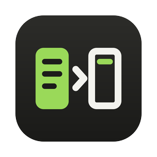

<!-- header -->

<h1 align="center">TotalFiles</h1>

Browse local folders and publish selected files over SSH.

  
  
  

<h2 align="center" id="download">Download</h2>

  <b>macOS</b> <a href="https://github.com/totaljs-es/totaljs-desktop/releases/download/totalfiles-latest/TotalFiles-mac.dmg">Apple silicon and Intel</a> 
  <b>Windows</b> <a href="https://github.com/totaljs-es/totaljs-desktop/releases/download/totalfiles-latest/TotalFiles-windows-x64-setup.exe">x64</a> · <a href="https://github.com/totaljs-es/totaljs-desktop/releases/download/totalfiles-latest/TotalFiles-windows-x64.msi">x64 MSI</a> · <a href="https://github.com/totaljs-es/totaljs-desktop/releases/download/totalfiles-latest/TotalFiles-windows-arm64-setup.exe">ARM64</a> 
  <b>Linux x64</b> <a href="https://github.com/totaljs-es/totaljs-desktop/releases/download/totalfiles-latest/TotalFiles-linux-amd64.deb">deb</a> · <a href="https://github.com/totaljs-es/totaljs-desktop/releases/download/totalfiles-latest/TotalFiles-linux-x86_64.rpm">rpm</a> · <a href="https://github.com/totaljs-es/totaljs-desktop/releases/download/totalfiles-latest/TotalFiles-linux-x86_64.AppImage">AppImage</a> 
  <b>Linux ARM64</b> <a href="https://github.com/totaljs-es/totaljs-desktop/releases/download/totalfiles-latest/TotalFiles-linux-arm64.deb">deb</a> · <a href="https://github.com/totaljs-es/totaljs-desktop/releases/download/totalfiles-latest/TotalFiles-linux-aarch64.rpm">rpm</a> · <a href="https://github.com/totaljs-es/totaljs-desktop/releases/download/totalfiles-latest/TotalFiles-linux-aarch64.AppImage">AppImage</a>

On a Mac with <a href="https://brew.sh">Homebrew</a>: <code>brew trust totaljs-es/tap &amp;&amp; brew install --cask totaljs-es/tap/totalfiles</code>

<!-- /header -->

TotalFiles is a file manager with two panels: two folders side by side, on your computer or on a server over SFTP, to copy, move and publish files between them.

## What it does

- **Two panels.** Each panel shows a folder of your computer or of a server. Filter by name, sort by name, size or date, show hidden files, and go back and forward through the folders you visited.
- **Tabs and favourites.** Open several folders in a panel as tabs, and keep the folders you use most as favourites. Each server has its own favourites.
- **Locations.** Your home folder, Downloads, the mounted volumes and iCloud Drive, one click away.
- **Copy and move without overwriting.** Files and whole folders go from one panel to the other. If the destination already has that name, nothing is replaced and you are told.
- **Trash.** Deleting moves the selection to the Trash of your system, after you confirm.
- **Archives.** Pack the selection as ZIP or TAR. Open a ZIP or TAR as a folder and extract only what you select, next to the archive or into the other panel.
- **Search in subfolders.** By name or by the text inside files (UTF-8, up to 1 MiB each), and jump to a match.
- **Sizes.** Folder sizes are counted in the background, and the status bar shows the selection against the total.
- **Preview and compare.** Space shows a text file. When both panels have a file with the same name, you see them side by side with their differences.

## Servers over SFTP

- **Connections.** Save a server with its folders on both sides. Sign in with a private key, a password or your SSH agent.
- **The key of the server.** The first time, TotalFiles shows the fingerprint of the server and waits for you to trust it. If it ever changes, it stops and asks again.
- **Publish safely.** Upload and download files and whole folder trees, with the current file, the speed and a button to cancel. A cancelled transfer leaves nothing half written.
- **What changed.** With a server on one side, each local file says whether it is only local or differs in size or date.
- **A copy of what you replace.** When an upload replaces a file of the server, the old one is kept on the server in a folder named `.totalfiles-…` next to it, and the result tells you where. Remove those folders when you no longer need them.
- **Changes under your feet.** If a file of the server changed since you listed it, the upload stops instead of replacing it.

## Keyboard

| Keys | Action |
| --- | --- |
| F5 | Copy, upload or download the selection to the other panel |
| F6 | Move the selection to the other panel |
| F7 | New folder |
| F2 | Rename |
| Delete | Move to the Trash |
| Space | Preview the file |
| Enter (on a file) | Open it with its app |
| ⌘R / Ctrl+R | Refresh the panel |

## Privacy

TotalFiles talks only to the servers you add. Passwords and passphrases are kept, if you ask for it, in the keychain of your system and nowhere else. Nothing is collected about you.

## Report a problem

[Open an issue](https://github.com/totaljs-es/totaljs-desktop/issues/new/choose) and choose TotalFiles, with its version and your system.
