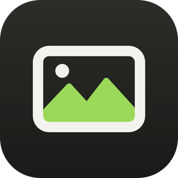

<!-- header -->

<h1 align="center">TotalImages</h1>

Make pictures lighter, resize them and change their format.

  
  
  

<h2 align="center" id="download">Download</h2>

  <b>macOS</b> <a href="https://github.com/totaljs-es/totaljs-desktop/releases/download/totalimages-latest/TotalImages-mac.dmg">Apple silicon and Intel</a> 
  <b>Windows</b> <a href="https://github.com/totaljs-es/totaljs-desktop/releases/download/totalimages-latest/TotalImages-windows-x64-setup.exe">x64</a> · <a href="https://github.com/totaljs-es/totaljs-desktop/releases/download/totalimages-latest/TotalImages-windows-x64.msi">x64 MSI</a> · <a href="https://github.com/totaljs-es/totaljs-desktop/releases/download/totalimages-latest/TotalImages-windows-arm64-setup.exe">ARM64</a> 
  <b>Linux x64</b> <a href="https://github.com/totaljs-es/totaljs-desktop/releases/download/totalimages-latest/TotalImages-linux-amd64.deb">deb</a> · <a href="https://github.com/totaljs-es/totaljs-desktop/releases/download/totalimages-latest/TotalImages-linux-x86_64.rpm">rpm</a> · <a href="https://github.com/totaljs-es/totaljs-desktop/releases/download/totalimages-latest/TotalImages-linux-x86_64.AppImage">AppImage</a> 
  <b>Linux ARM64</b> <a href="https://github.com/totaljs-es/totaljs-desktop/releases/download/totalimages-latest/TotalImages-linux-arm64.deb">deb</a> · <a href="https://github.com/totaljs-es/totaljs-desktop/releases/download/totalimages-latest/TotalImages-linux-aarch64.rpm">rpm</a> · <a href="https://github.com/totaljs-es/totaljs-desktop/releases/download/totalimages-latest/TotalImages-linux-aarch64.AppImage">AppImage</a>

<!-- /header -->

TotalImages makes pictures lighter: it packs them tighter, makes them smaller and writes them in another format, one by one or by the folder.

## What it does

- **Drop and go.** Drop pictures or whole folders on the window, or choose them. It reads JPEG, PNG, WebP, GIF, TIFF and BMP, and on a Mac the HEIC of phones.
- **Formats.** Write them as JPEG, PNG, WebP or AVIF, or each in the format it has, with the quality you choose for the formats that have one.
- **PNG with fewer colours.** For screenshots and logos: a PNG with at most 256 colours, or fewer, is far lighter and keeps what is see-through.
- **Pictures that move.** A GIF or a WebP that moves is written as a WebP that moves, with all its frames.
- **Size.** Make them fit inside a box or take a part of their size. A picture is never made larger.
- **Compare before you save.** A picture next to its lighter copy, with a line to move between them and the quality to try while you look.
- **Settings with a name.** Three given (for the web, for mail, thumbnails) and your own.
- **How much you saved.** Each picture shows how much lighter it is, and the list its total. A picture that cannot be lighter is left as it is.

## Where they go

- **Next to the original**, in another folder, or in the place of the original, which goes to the trash of your system.
- **Names from a pattern**: the name it has, its number in the list and its size.
- **Nothing is written over.** A name that is taken gets a number.

## On its own

- **Watched folders.** A picture that arrives in a folder you watch is made lighter at once, with the settings of the moment.
- **The clipboard, on the Mac.** A screenshot sent to the clipboard is made lighter there, so it is pasted lighter into a mail or a chat. A picture copied with its page or its file is left alone.
- **With the window closed.** While it has folders or the clipboard to watch, TotalImages stays next to the clock of your system, and comes back from there.

## What a picture says about itself

- **The date, the camera and the place** are left out, unless you ask to keep them. They are kept in JPEG, PNG and AVIF.
- **The turn the camera noted** goes into the picture, so it looks the same everywhere.
- **The colour profile** is kept in JPEG and PNG.

## Good to know

- AVIF gives the lightest files and takes the longest to write.
- HEIC is read on the Mac only, by the system itself.
- A picture that moves keeps moving only as WebP.

## Privacy

TotalImages works on your computer and talks to no one. Your pictures never leave it, and nothing is collected about you.

## Credits

This software is based in part on the work of the Independent JPEG Group.

## Report a problem

[Open an issue](https://github.com/totaljs-es/totaljs-desktop/issues/new/choose) and choose TotalImages, with its version, your system and the format of the picture.
